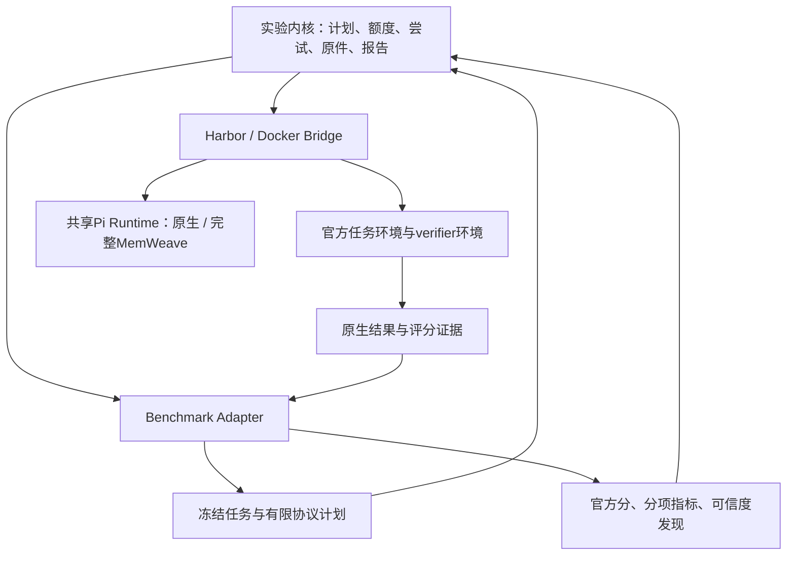

# Benchmark适配层技术方案

日期：2026-10-29。状态：**两项关键边界已获用户确认，适配层尚未实施。** 审计基线为仓库`0b75134`及本机Harbor 0.24.0；形成提案时重新执行的190项实验开发检查通过，未运行新模型、改历史成绩、修改产品或发布npm。本次仅同步两项确认，接口、schema和迁移方案仍按本文建议展开。

## 第一部分：目的、边界与关键取舍

### 1. 建议采用的结构

保留Harbor／Docker作为运行底座，将当前分散在配置、Pi启动、调度和报表中的benchmark知识收进受版本管理的适配器。实验内核只处理实验计划、资源、费用、原件、尝试和结果；每个适配器负责把某个benchmark接成统一任务，并解释它自己的交接和评分协议。

常规新增benchmark应只增加一个适配器目录、注册项、任务清单及对应验收，不再往底层增加`if benchmark == ...`。不承诺任意新执行形态都能靠配置解决：需要GPU、多服务、浏览器、真实外部账户或新交互驱动时，先检查底座是否支持；不支持就明确阻断，再单独评审能力扩展。

**用户已确认：“容器不变”指运行、隔离、缓存和资源机制稳定，保留各题官方镜像。** 现有SWE与TB题目有不同系统依赖、运行用户、工作目录及评分环境。使用各题官方镜像／原Dockerfile构建成果；每次从相同干净起点创建可写实例。Node、Pi、插件和检索模型资源可缓存，题目修改、数据库、Session、Task、State及可写检索索引不能跨尝试复用。

### 2. 为什么不能只包一层配置

49题经历说明，差异不只在数据目录：

- SWE Pro V2要求离线解题、捕获补丁、全新沙箱评分；TB任务可能原沙箱评分，也可能由Harbor启动官方独立verifier。
- T11必须只重放完整原产物补评分，不能再次调用模型；S14／S32还需要保留预算／资源结束及已捕获答案。
- T13的外层pytest全过不等于业务reward通过；S35甚至能在bailout时得到官方1。单纯统一JSON字段不能保证成绩可信。
- GNU／musl、非root用户、镜像index与平台内容、软件冷准备和Docker观察故障属于公共运行底座问题，不应分别在每个benchmark里修一遍。

因此采用**两个适配边界**：benchmark到实验任务／协议的适配，以及实验任务到Harbor／Docker的桥接。Pi运行时独立于两者，继续使用真实Pi CLI与完整生产扩展。

### 3. 用户已确认的两项决定

| 决定 | 已确认选择 | 影响与边界 | 当前状态 |
|---|---|---|---|
| 容器稳定的含义 | 固定容器机制与配置profile，保留各题官方镜像 | 不把不同公开任务强行重建到统一基础镜像；每次仍用干净实例 | 2026-10-29用户明确确认 |
| 已确认严重评分漏判的任务 | 阻断进入主能力对照，保留官方原分、完整行和证据 | 按任务隔离，两变体一致标记；不能靠剔除不利侧或删除行美化结果 | 2026-10-29用户明确确认 |

第二项作为新适配层后续实验的默认**成绩可信度／准入规则**，实施时须显式落实。原49题及其27／25、首次分数和历史费用保持原样；允许另生成新策略的审计视图，不覆盖原报告。两项确认已同步至[实现设计§8.3](IMPLEMENTATION_DESIGN.md)；本文其余接口、schema及迁移细节仍是实现建议，不将本次答复解释成已完成代码接入。

现行[实现设计§3／5](IMPLEMENTATION_DESIGN.md)和根[AGENTS.md§2](../../AGENTS.md)要求新接口、字段及恢复语义先对齐；旧设计明确未预建通用Backend协议。本次仅建议一个有限的内部适配层；确认后再最小修改直接相关设计并实施，不先改代码。

### 4. 规模与不做的工作

先把**现有TB4与SWE Pro V2完整抽取为两个适配器**，证明新结构能保持原协议和历史可读性。继续锁定已验收的Harbor 0.24.0、Pi 1.4.0及现有候选运行方式，不把本次重构与依赖升级绑在一起。

不建设调度服务、插件市场、任意DAG工作流、第二套Agent Loop、聊天数据库或分布式平台。首版只有Harbor＋Docker一种运行实现；不为尚未使用的Kubernetes／云沙箱提供空壳接口。MemWeave_RSI未来可复用这套底座，但本轮不加入自进化职责。

## 第二部分：审计依据与技术设计

### 5. 当前代码中需要收敛的耦合

| 已核对位置 | 当前情况 | 目标归属 |
|---|---|---|
| [spec.py](../../experiments/src/memweave_eval/spec.py)，Suite | benchmark ID、仓库、目录、protocol枚举写死两个集合 | 适配器注册描述；核心只校验注册身份及输入schema |
| [runner.py](../../experiments/src/memweave_eval/runner.py)，build_job_config／tool_environment | 选择PatchReplayAgent、禁用solve verifier、加入v2/tooling；同时处理通用Harbor配置和私有认证 | 协议来自adapter；Job编译在bridge；认证在runtime |
| [pi_agent.py](../../experiments/src/memweave_eval/pi_agent.py)，run／exec_as_agent | Pi安装与完整扩展加载，同文件又判断Pro网络、2940秒包装及git补丁捕获 | 通用Pi运行时＋显式受限执行／交接策略 |
| [campaign.py](../../experiments/src/memweave_eval/campaign.py)／[paired.py](../../experiments/src/memweave_eval/paired.py) | 多入口重复编排阶段；穿插两个集合名称、补丁／产物分支、49题catalog SHA及历史例外 | 一个常规控制器；benchmark协议和选题数据移出内核 |
| [report.py](../../experiments/src/memweave_eval/report.py)／[campaign_report.py](../../experiments/src/memweave_eval/campaign_report.py) | 根据benchmark选择评分来源、验证重放；依赖gNN目录和parents层级 | adapter解释评分，统一证据引用；legacy reader保留旧布局 |
| [artifact_replay.py](../../experiments/src/memweave_eval/artifact_replay.py)及paired中的AUDITED常量 | T11／S14／S32用精确SHA识别历史特例 | 旧例外留在只读legacy；新尝试使用阶段回执和答案身份，不扩充题号白名单 |
| [images.py](../../experiments/src/memweave_eval/images.py)／runtime_cache.py／private_runtime.py | 已有官方镜像冻结、协议等价检查、软件对象和musl能力 | 保留为平台能力；不搬进各benchmark |
| [live.py](../../experiments/src/memweave_eval/live.py) | 原生Session增量观察已可复用，但仍依赖固定目录；最终全来源峰值需另脚本复核 | 使用尝试／原件索引，统一实时与最终统计 |

8个被检查模块均出现benchmark／protocol专名；问题是职责分散，而非需要重写所有5690行实验代码。原先为完成49题做的精确例外具有历史审计价值，不能在重构时删除后假装旧实验从未遇到这些情况。

当前`local_baseline`**尚未接入实验执行代码**：[设计](LOCAL_BASELINE_DESIGN.md)仍是待确认草案，[发布测试](../../发布测试/README.md)是独立入口。不能把既有发布检查、历史长任务报告当作已实现的第三个benchmark适配器。

这批实验的具体教训对应如下，不能把所有故障都塞进adapter：

| 经验 | 应修正／固化的位置 | 不应采用的处理 |
|---|---|---|
| TB独立verifier未继承主服务平台，shared／bundled_tests有不同回退语义 | 平台桥接使用Harbor有效配置解析，冻结全部角色 | 每个benchmark复制一套Docker启动脚本 |
| T07同层重建产生新index，旧attestation归档不完整 | 公共镜像身份与归档范围 | 只比rootfs就谎称原镜像完全恢复 |
| npm中断、musl原生依赖失败 | 公共软件准备／ABI能力与内容缓存 | 每接新题临时改Pi或系统libc |
| T12的0600配置属于宿主UID，对nobody不可读 | 公共运行用户／私有文件部署 | 把Agent统一提权root |
| S05镜像无curl，网络探针在Pi前失败 | 公共网络实现读取adapter声明的网络约束 | 在每道题安装额外系统工具 |
| S03／T07等被公共故障联动取消 | 内核错误分域、已捕获答案的评分收尾 | 正常一侧也反复整对重跑 |
| S14／S32预算／内存结束，T11只缺评分 | 尝试、答案、评分三者分离 | 在公共执行代码不断追加题名／SHA例外 |
| S35忽略bailout；T13外层测试与业务reward不同 | adapter的评分解释与可信度检查 | 统一按exit=0或pytest通过率计分 |
| S34的mock时序与真实清理缺陷并存 | adapter审计记录及有边界的独立诊断 | 为让公开成绩变绿修改官方测试 |
| 最后阶段峰值4，全来源实际峰值7 | 内核跨run的去重观察与资源阶段账本 | 用准备／评分容器凑10并发 |
| catalog追加、旧路径层级和恢复代码身份耦合 | 清单版本／amendment和原件引用 | 每次增加候补都修改公共catalog识别代码 |

### 6. 复用Harbor，避免重复建设

官方[Harbor Adapters](https://github.com/harbor-framework/adapters)负责把外部数据集转换成Harbor任务目录；本项目优先复用已有官方任务，必要时复用经审查且锁定的转换器。本项目适配器再补齐实验需要的协议绑定、交接、评分解释和审计。二者分工不同，不再发明另一种完整任务目录格式。

本机0.24.0实际源码核查结果：`Job.create`／`JobConfig`可作为Job边界；`TaskConfig`、`resolve_task_verifier_mode`及`resolve_verifier_environment_definition`可展开环境语义；`BaseEnvironment`提供传输／执行与能力检查；`ArtifactHandler`可按官方artifact定义采集与重放。使用这些已有能力，不调用`Trial._run_*`等内部阶段方法来建立第二个调度器。[固定版本配置](https://github.com/harbor-framework/harbor/blob/v0.24.0/src/harbor/models/job/config.py)、[verifier解析](https://github.com/harbor-framework/harbor/blob/v0.24.0/src/harbor/models/task/verifier_mode.py)

0.24.0还有`SourceJobConfig(action=regrade/diff)`。它是否满足Pro官方PatchReplay和TB指定产物交接，仍需逐协议验算，不能因名称叫regrade就直接替换现有路径。第一阶段沿用已验证的官方PatchReplayAgent／ArtifactHandler。

在线独立adapter仓库的当前布局不等于已验证与本机0.24.0兼容；接入时固定具体converter提交及依赖，不自动安装main或升级Harbor。转换器若需要额外依赖，在独立准备环境运行，不能污染执行器的锁定虚拟环境。

### 7. 层次与运行数据流



Adapter产生数据和受审查策略；不拥有费用账本、线程池、容器客户端或第二个Pi启动入口。核心不根据benchmark名字分支。Harbor仍管理实际Trial及环境生命周期；内核只管理实验阶段依赖和提交给Harbor的工作。

上图箭头是运行数据流，不是模块循环导入。代码依赖统一指向纯`contracts`：core依赖adapter／bridge接口，具体实现由CLI组合；adapter不导入控制器，平台和Pi运行时也不导入具体benchmark。只有静态注册表包含adapter ID到实现的映射。

### 8. 最小适配器接口

以下为拟议内部接口，**不是已存在的可调用API**：

```python
class BenchmarkAdapter(Protocol):
    descriptor: AdapterDescriptor

    def catalog(self, source: SourceSnapshot) -> TaskCatalog: ...
    def materialize(self, task: TaskRef, source: SourceSnapshot,
                    output_dir: Path) -> TaskBundle: ...
    def protocol(self, task: TaskBundle) -> TaskProtocol: ...
    def interpret(self, evidence: EvaluationEvidence) -> GradeInterpretation: ...
```

- `catalog`枚举任务和可用于选题的公开元数据，不运行模型、不用答案／成绩选题。
- `materialize`从已冻结输入生成／引用Harbor任务及转换回执；不直接启动容器、访问认证或改变宿主依赖。
- `protocol`声明官方阶段、资源／网络、交互方式、答案交接和评分来源，不自行执行工作流。
- `interpret`读取已有官方结果，返回原分、分项和格式／完整性疑点，不补跑模型、不覆盖原件。

接口只允许仓库内经审查的静态注册实现。配置提供adapter ID，不提供任意Python import_path／主机shell回调。允许的官方host-side tooling同样必须明确审查、锁定模块与依赖哈希；不能把完整数据集checkout随意加入主机PYTHONPATH。接口不是恶意第三方Python代码的安全沙箱，首版不开放任意外部插件执行。

### 9. 四类共同数据边界

| 数据 | 必要内容 | 约束 |
|---|---|---|
| `TaskBundle` | benchmark／task ID、来源提交与内容SHA、官方任务目录、可见材料和隐藏评分边界、转换器身份／diff | 沿用Harbor任务格式；不向Agent暴露solution／tests／完整数据集 |
| `TaskProtocol` | 已支持能力要求、官方各阶段预算／资源／网络、控制检查、CLI交互方式、评价模式、答案捕获及可重放范围 | 有限策略，不是可执行DAG；用户环境profile不能静默覆盖官方要求 |
| `SolutionBundle` | 原attempt、task／variant、原答案位置与SHA、格式、捕获范围及完整性 | 原生Session不算业务答案；插件记忆只作诊断，不送给grader |
| `GradeInterpretation` | 原官方reward、是否实际完成评分、分项指标、可信度发现及证据引用 | 测试项通过数不改造成官方分；错误／未知不默认转0 |

每个adapter同时绑定ID、接口版本、实现内容SHA、上游提交和tooling SHA。语义版本号用于兼容声明，不能代替字节冻结和实际验收；升级adapter也不能自动继承旧模型成绩。

控制检查由adapter明确声明：现有TB／Pro保持oracle=1、nop=0；其它计分方式不机械套用1／0。没有官方参考解的benchmark必须提供已审查的正确／错误答案控制或等价验证方法；无法证明评分链路正常就不准入，不能虚构oracle或略过检查。转换阶段同样禁止隐式模型调用。

`EvidenceRef`统一使用`run_id + 相对路径 + SHA256 + 类型`。新运行不再从`parents[5]`、`gNN`、绝对用户目录或任务名截断反推身份。显示题号、逻辑槽位、实际替补题和Harbor Trial ID分开；容器ID与Trial／角色映射在容器存在时就记录。

### 10. 现有两套benchmark如何映射

| 项目 | TB4 adapter | SWE Pro V2 adapter |
|---|---|---|
| 输入 | 官方Harbor任务 | 官方v2/tasks，保持来源版本 |
| 镜像 | 按原Dockerfile／官方独立verifier定义，由公共平台准备 | 官方linux/amd64镜像，由公共平台解析并冻结 |
| Agent网络 | 保留官方任务定义 | 官方离线要求＋受控模型端点例外，端点取自模型profile |
| 解题 | 真实Pi CLI，预算来自官方任务 | 真实Pi CLI，保持50分钟任务预算及已确认的2940秒内层／收尾口径 |
| 首评 | Harbor按原任务shared／separate模式执行 | solve明确禁verifier；捕获原补丁后，用官方PatchReplayAgent全新沙箱评分 |
| 答案 | 依任务定义的官方产物；普通首评可能依赖原沙箱状态 | 官方补丁格式及变体独立交接目录 |
| 后续只评分 | 仅当官方产物足以完整重建评分输入时支持 | 绑定同一原补丁，使用相同冻结协议 |
| 解析 | reward为主；T13轨迹等作为分项，不能用pytestfooter替代 | 官方reward和required tests；另检测已知解析漏判／不完整 |

“Harbor原生verifier独立环境”与“解题后启动另一份PatchReplay Job”是两个不同概念，不能合并成一个含糊的`separate=true`。Pro V2的README／任务默认值矛盾由已确认的adapter协议表达，不能下沉为所有benchmark的全局默认。

### 11. 环境profile与Pi运行时

环境profile配置Docker连接引用、平台、可用CPU／内存／磁盘、支持能力和准备并发；Pi profile配置精确Node／Pi、候选归档、完整入口、模型连接引用与私有认证引用。已有环境健康检查、镜像冻结、归档验证、公开npm缓存、GNU／musl、UID／GID、软件对象和网络探针保留为公共实现。

有效环境由“官方任务要求＋已批准runtime接线＋平台能力”合成。profile是宿主边界，不是把官方8GiB改成4GiB、把离线改公网、把shared verifier改独立的覆盖文件。要求无法满足就返回不支持／阻断，不能偷偷降级。

实验层不替Agent修改Jest worker数量、补写答案或State来避免能力失败；它负责如实约束／记录资源与结束原因。S32这类验证命令选择仍是被测行为，不能借平台适配消除。

缓存继续分为官方镜像／层、Node／Pi软件、插件依赖、检索模型资源；凭据、配置、Session、Task／State和可写索引始终独立。正式解题只能读取已密封缓存，不能隐式下载安装；缓存损坏先保留证据和阻断引用它的工作，再用显式新准备记录修复。

准备配方从benchmark协议代码中分离，按实际安装代码及其依赖闭包生成身份。迁移时先兼容旧缓存描述，不因为移动Python文件就重建全部软件；也不把旧对象改名假装新身份。初版仍按镜像／平台／运行时保守分键，不顺便实施跨不同系统镜像的安装产物复用。

镜像记录区分发布index、平台manifest、config／rootfs、Docker实际ID、构建context与Dockerfile SHA。相同层不能代替原index身份；缺attestation要标明归档范围。镜像清理只处理不再被活动／待评分工作引用的对象，不能全局prune或删除仍需原图重评分的唯一副本。

Pi Runtime不再识别`swe-pro-v2`字符串，接收已验证的执行预算、网络约束和交接策略。仍由Harbor Installed Pi调用正常Pi CLI；不fork循环、不改System／Rule、不缩减工具、不通过简单模型API替代真实解题。原生Pi不加载插件包或检索模型。

### 12. 运行阶段与并发

固定过程为：冻结来源／清单 → 准备官方环境 → 官方控制与评分器审计 → 同题两侧完整运行时预检 → 真实解题 → 原协议评分 → 原件提交及报告。TB的评分可能已在同一Harbor Trial内完成，不再重复发一个评分Job。

准备、control、solve和grade共享物理资源总账，但分开计阶段用途。准备中的任务不预占“真实解题”名额；冷软件构建有独立有限并发，已有缓存就绪的题可绕过慢准备。执行资源仍由同一个额度分配器核验，不因拆阶段而超卖内存或漏算评分容器。

当前`paired.worker`在进入包含准备的整题对流程之前取得最大资源包络，直到评分结束才释放。它较保守，能阻止超卖，但也会让冷准备占住可用于就绪解题的容量；这是峰值仅7的一个机制因素，不能据此断言是唯一原因。

推荐改为阶段资源租约，初版只支持上面的有限阶段。Harbor负责每个Job中的Trial并发；内核不额外建立逐Trial调度队列。目标10属于可配置上限和实测指标，不能靠空容器／grader凑数，资源不够时报告实际并发与等待原因。

等待发生在提交相应工作前，实际任务计时仍采用Harbor和benchmark规定的起止边界；拆阶段不是把已经开始的官方解题预算暂停、重置或延长的理由。

保持常驻观察，不创建cron或桌面定时任务。合并全部阶段与来源的真实解题区间，统一实时与最终峰值；安装／control／grader／sidecar单列。额度使用单调时钟，原宿主／guest时间保留并检查异常，不以墙钟回拨延长预算；Docker观察采用元数据查询，不能再次隐式触发Size遍历。

### 13. 尝试、答案和评分分离

一个逻辑样本由冻结的benchmark任务、variant、seed／repetition及实验身份组成。真正启动解题产生一个solve attempt；只评分产生独立grade attempt并引用同一SolutionBundle，不能再创建一次解题。

执行结束原因、答案捕获完整性、官方评分和成绩可信度分别保存。例如：S32应能表达“资源结束＋捕获了补丁＋官方0”，T11应表达“解题完成＋首次评分超时＋原产物首个有效0”；不能只用一个success字段推断是否该重跑。

| 原件状态 | 下一步 |
|---|---|
| 有可信证据证明尚未启动Pi／可能的模型请求 | 修复准备后允许首次有效解题，旧准备失败保留 |
| 已启动Pi但usage／费用未知 | 不凭日志缺失断言0调用，不自动重跑；先审计并保留unknown |
| 已完成解题、有可重放原答案但缺有效评分 | 只运行允许的官方评分，不调用模型 |
| 已有正常有效首0／首1 | 不因对照不利重跑；独立新seed／实验必须新建计划 |
| 官方预算／资源结束且捕获部分答案 | 按benchmark已声明协议决定能否评分；保留原异常，不能泛化放行所有137 |
| 原件损坏、交接不完整、来源／身份不一致 | 阻断引用；不以重跑生成“同一份原件” |

新阶段回执记录进入解题／交接／评分的事实和证据，先写启动边界再允许推理。生命周期事件只是元数据，不另存全量聊天；原始交互继续只有Pi Session。恢复键绑定源任务、adapter／协议、候选、模型参数、variant、运行时和答案SHA；代码／协议变化默认拒绝自动继承，等价迁移需独立审查回执。

Solve身份与Grade身份分别冻结：前者绑定任务／候选／模型／variant／seed及有效执行环境，后者再绑定原SolutionBundle、grader／解析器／评分环境。只修改评分解释或可信度检查时，产生新的解释／审计记录，不默默覆盖旧解释，也不借此重跑模型。修改候选或模型则属于新的比较计划。

Pro官方文本补丁若只有binary marker，要明确捕获范围，不能宣称二进制原工作区已完整恢复；不擅自给官方补丁命令加参数改变口径。TB没有完整可重放产物闭包的任务，不提供只评分恢复。插件记忆和Session不能补充进业务答案，亦不能恢复给下一次解题。

### 14. 错误分域，避免一题拖停全部

| 故障 | 默认影响范围 | 保留与处理 |
|---|---|---|
| 某题镜像／ABI／官方控制失败 | 该任务及两变体 | 模型前按已冻结候补规则处理，没候补保留blocked行 |
| 某个共享缓存损坏 | 引用该对象的工作 | 隔离对象、显式恢复；不重跑已经正常解题的侧 |
| 评分器错误／不稳定 | 该任务的grade／可信度 | 原reward不改，不把解析故障当Agent能力0 |
| 认证、费用未知或公共观察失效 | 暂停相应共享推理范围 | 停止新增付费工作，保存原件；安全时仍可为已捕获答案无模型收尾 |
| Docker宿主故障 | 该宿主 | 不冒充所有题答错；恢复后按答案／评分事实决定续做范围 |

自动重试只允许事先声明的无模型准备操作；下载重试仍校验同一内容，不变成换镜像／依赖。是否重启真正解题只能由内核恢复策略决定，adapter无权反复启动Pi。未知影响范围时先阻断相关公共入口，不能把每个任务错误都升级成全局联动取消。

### 15. 评分可信度独立于官方分

建议结果同时展示三件事：官方原reward及原件、评分过程是否完整、该成绩是否可进入主能力对照。后两项不回写官方reward。

- T13：外层pytest4／4可与业务13／28、reward0同时成立；使用官方reward，业务轨迹另列。
- T11：超时前预写的reward0不是有效首分；需要确认评分实际完成，不能只检查文件存在。
- S35：adapter的已知ospec审计可检测“All assertions passed”同时仍有bailout；不能把固定suite标签数量当实际运行通过数量。
- S22／S34：测试调用形状、同步mock与公开接口／异步时序的争议需证据审查，不能通用搜索stderr里的“Error”就判成绩无效。
- S06／T14：后续相同答案的诊断波动不覆盖首分；环境波动与真实竞态分别定位，重复评分不用于挑最高分。

每个adapter的解析及可信度检查器都要独立版本化，保存识别依据；未知格式返回unknown而非0。官方测试若有缺陷，保持原轨道原件，修正版只能在明确命名的新协议下运行，不能悄悄替换。

这里的未知指评测证据缺失或评分器协议／格式不能确认。若Agent交付的业务JSON、源码或其它产物违反公开合同，而评分器正确识别，应是有效失败，不因出现JSONDecodeError等文本就改成“平台问题”。

按用户已确认的“严重漏判阻断”策略，完整任务矩阵仍保留：quarantined行显示原reward、风险和“不可作主能力判断”，同题两变体一致处理。同时报告计划N、可信已评M、可信通过K及未知／阻断数；M小于N时不发布假装全覆盖的确定成功率，不用K/M偷偷替换原分母，也不把未知直接扣成能力0。官方参考表仍可照录原分；历史49题报告不被该新策略改写。

### 16. 推荐目录与配置

```text
experiments/
  benchmarks/
    terminal-bench-4/manifest.yaml
    swe-bench-pro-v2/manifest.yaml
  profiles/                       # 非敏感运行能力／Pi版本，认证只放引用
  subsets/                        # 选题与候补数据，不属于adapter代码
  src/memweave_eval/
    contracts.py                  # 纯数据契约，不依赖Harbor／Pi
    core/                         # 计划、资源／费用、尝试／原件、离线报告
    benchmarks/
      registry.py
      terminal_bench_4/           # 转换引用、协议、评分解释／审计
      swe_pro_v2/
    platform/                     # Harbor桥接、镜像、缓存、网络、健康观察
    agents/                       # 共享Pi运行时与正式入口
    legacy/                       # 只读schema1／2与已审查历史例外
  tests/
    contracts/
    adapters/
    platform/
```

这是职责划分，不要求先拆成大量文件或各自发布Python包；以最少实际接口落地。原venv／依赖锁继续独立于产品npm包。新adapter的安装依赖不是Agent业务依赖，也不能修改官方任务的lockfile。

`manifest.yaml`是adapter身份、允许来源与能力声明的单一来源，`descriptor`校验加载它，不在Python类里平行手写一份相同配置。官方各题预算仍读任务定义；复杂协议和评分解释留在同目录代码并与测试一起冻结。

未来配置草图，字段尚未定稿，**当前CLI不能直接读取**：

```yaml
schema_version: 3
environment_profile: profiles/local-colima.yaml
agent_profile: profiles/pi-1.4.0.yaml
model_profile: private-profile-reference
benchmarks:
  - adapter: terminal-bench-4
    source_lock: sources/tb4.lock.json
    selection: subsets/tb4-long.yaml
  - adapter: swe-bench-pro-v2
    source_lock: sources/pro-v2.lock.json
    selection: subsets/pro-long.yaml
execution:
  target_model_concurrency: 10
```

来源提交、转换器、官方任务和准备后的镜像／软件身份在run lock中冻结。模型、候选、运行能力与任务选择分开配置；首版模型profile仍仅使用现有已验收的DeepSeek接线，不因schema变通用而宣称已支持其它供应商。费用／整体时限或显式无限额仍需在真实运行前明确，不把旧49题授权自动当作新适配器付费验收额度。

### 17. 新benchmark的接入步骤与边界

1. 优先检查是否有原生Harbor任务；其次检查固定版本官方converter及其协议差异。已有转换器不代表天然与原评测等价，必要时做原框架／Harbor的parity验证。
2. 只读公开材料先形成catalog，固定来源、选择规则及候补；金标和隐藏测试不得用于按被测成绩挑题。
3. 用四个接口接入，声明能力和唯一评分来源；没有新能力需求时不改core／platform／agents。
4. 在无凭据准备中完成镜像、官方控制和评分器自检；对当前任务完成两侧完整Pi加载检查，再允许解题，不等待整个benchmark准备完。
5. 另经授权运行一个原生／插件真实Pi题对闭环，核对答案交接和原官方评分，再扩大规模。无模型Mock／SDK检查不代替此项。

首版支持现有Linux CPU单主服务、已验收架构及两种现有评价流程。多服务、GPU、浏览器／远程交互、LLM-as-judge、需要新外部账户的任务标为需要能力扩展，不自动走主机shell或换评分方法。支持范围不等于无限兼容承诺。

### 18. local_baseline如何放入同一体系

能力部分可实现为repo内的benchmark adapter，任务、rubric和评分器冻结，业务能力按已确认的0—100标准另列，不与公开0／1成绩混平均。多轮／进程恢复需要Pi官方RPC驱动时，把它作为agents层的明确能力评审；不能假装当前单提示CLI已支持，也不把缩小Window当真实长程基线。

发布功能回归继续调用`发布测试/`既有入口，输出gate／N/A和证据引用；它不等于一个要求原生Pi获得插件工具的能力benchmark。真实宿主／分发检查不能强行塞进Docker后声称等价，实验系统只能汇总其独立验收记录。local_baseline原草案中的评分决定与预算仍须单独对齐，本提案不宣布它已实现或通过。

### 19. 渐进迁移，保护已完成49题

| 阶段 | 修改范围 | 退出条件 |
|---|---|---|
| A：先定边界 | 落实两项已确认决定，继续对齐接口、schema及迁移细节 | 接口、准入／恢复及新结果语义清楚，不改产品规范 |
| B：抽取两个adapter | 先保持原任务／Harbor配置／Pi命令语义，移出协议分支 | 原190项保持通过；两套冻结fixture输出等价，未修改原49题结果 |
| C：统一常规执行入口 | core只消费计划；环境和Pi runtime只接能力／策略 | 新增一个小型Harbor格式示例adapter无需改core／platform／agents；作为接入测试，不算能力成绩 |
| D：新尝试与可信度契约 | 引入明确答案／评分引用、阶段租约、审计发现及schema3 | 故障注入与只评分恢复边界通过；有授权的真实小闭环通过后才扩跑 |
| E：本地套件 | 另落实local能力rubric／RPC与发布回归汇总 | 两轨分别验收，仍不自动授权npm发布 |

schema1／2报告和原目录由legacy reader只读支持。旧catalog SHA例外、S14／S32／T11原件白名单保留为历史解释，不复制到新的常规路径。原49题主分、10个历史尝试、费用及首次评分不迁写、不择优替换；用旧原件做离线影子归一对照，不再调用模型来验证“重构后还得同分”。

新执行入口先显式选择新schema／引擎；完成切换验收前保留旧入口，不在重构中突然使旧配置失效。可提供生成待审新配置的迁移器，但不得把旧completed_parent自动翻译成新恢复授权。迁移完成后只长期保留旧报告reader，避免永久维护两套调度器；旧执行入口的退役点列入阶段A的确认范围。

旧原件的绝对路径问题也不能靠删除原验证解决。第一阶段继续在现有原件根读取；若以后迁移旧根目录，另作显式位置映射及完整SHA验收，不伪称旧记录已经天然可移植。新EvidenceRef从一开始使用相对引用。

### 20. 验收必须覆盖的反例

- **层边界：** 新增adapter不改公共内核；无benchmark专名分支渗入Pi runtime／平台；任意import_path／host shell配置被拒绝。
- **协议：** 修改指令、预算、资源、网络、cwd、运行用户、verifier模式或tests上传语义必须被发现；Pro禁止原沙箱评分、TB不被统一强改独立评分。
- **身份：** shared／separate角色、平台manifest与index、源任务／运行副本、同题两variant及原补丁／产物绑定正确；答案串侧、档位替补变化、原件篡改拒绝。
- **真实运行：** 正式能力尝试是完整Pi；prepare_only无凭据／模型；原生没有插件；不能用供应商API调用冒充Pi。
- **缓存：** 命中不重复下载；损坏不降级重装；同对象仅一个写者，已就绪读者不被慢构建卡住；非root和musl单独验收，无解题状态进入缓存。
- **续跑：** 一侧模型前失败、另一侧正常0时只补缺侧；有答案无分只评分；未知usage不当作0；预算／137／VerifierTimeout不靠题名或最高分决定恢复。
- **评分：** T13式外层全过／reward0、S35式bailout／reward1、预写reward后超时、未知格式、部分产物和测试接口争议均有独立fixture；原分与可信度分列。
- **统计：** 全阶段费用只计一次，历史attempt保留；阶段峰值不冒充全批；并行Trial时间不相加成墙钟；blocked／unknown不伪装能力0。

评分器fixture至少包含正确、空、错误、等价格式和针对性缺陷；同一原件重复解释至少三次一致。真实官方评分是否稳定需另按任务验证，不能从解释器确定性推导所有模型／并发运行稳定。新adapter代表性任务做实际无模型控制与必要parity，避免为了准入让整批每题无条件重复三遍耗尽准备时间。

### 21. 本轮审计证据与尚未验证的部分

形成提案时实际重跑`PYTHONPATH=experiments/src experiments/.venv/bin/python -m pytest experiments/tests -q`，190项通过；JUnit在仓库外`analysis/adapter-design-audit-20261029.xml`。核对本机Harbor 0.24.0的Job／Task／Environment／Pi／ArtifactHandler类型及源码，结合[49题恢复验收](LONG_HORIZON_49_CONTINUATION_VALIDATION_2026-10-29.md)、[最终报告](LONG_HORIZON_49_FINAL_REPORT_2026-10-29.md)和[疑难记录](../DIFFICULT_CASES.md)。本次确认只更新文档及审计状态，未重复执行该回归。

[审计快照](results/benchmark-adapter-audit-20261029.json)记录20个模块的内容SHA、行数、专名静态出现计数和本轮190项结果；计数用于定位耦合，不把字符串出现次数当缺陷数量。

这些检查证明当前基线和审计依据存在，**不证明新适配层已实现或通过**。未运行新benchmark、未安装／升级Harbor、未做新的付费Pi验证。现有官方converter的协议转换与本机版本兼容，须在实际选定后逐个验收。[官方适配器说明](https://github.com/harbor-framework/adapters)、[适配与parity研究](https://arxiv.org/abs/2609.04298)仅作为复用方向的参考，不替代本机固定版本证据。
